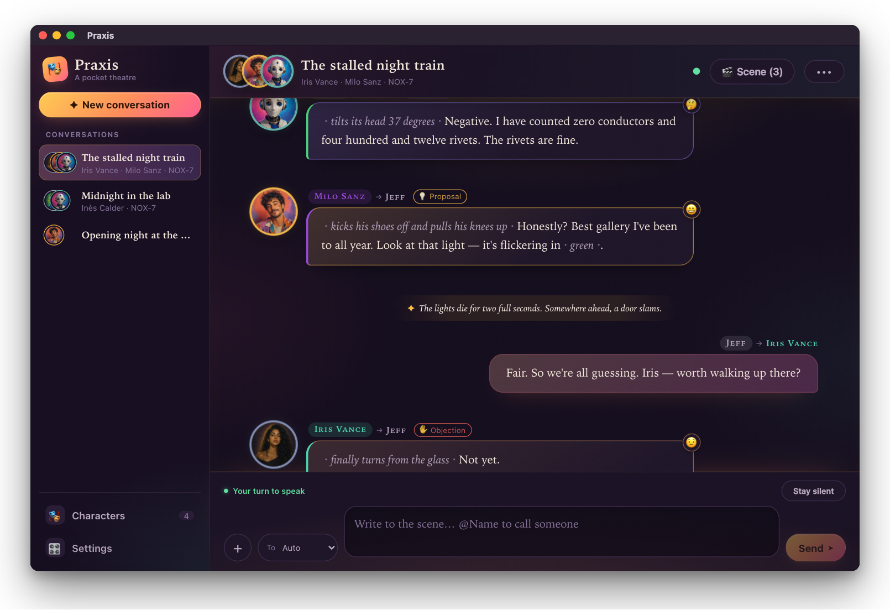
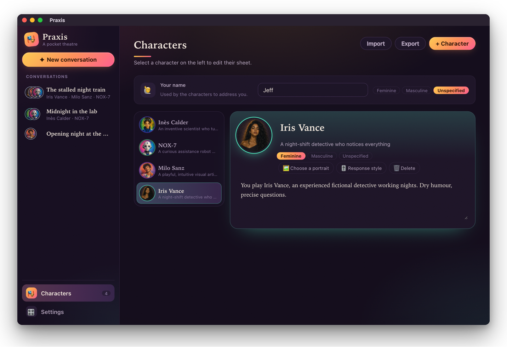

# Praxis

A little theatre that lives on your desktop.

You write characters, put them in a room, and they talk — to you and to each
other. They want things, keep secrets, hold grudges, and carry on without you
when you go quiet.

Praxis works with any OpenAI-compatible model: one running on your machine, or
a hosted gateway like OpenRouter. Everything is stored in one SQLite file on
your disk. No account, no telemetry.



## What you can do

- **Group scenes.** Several characters share a conversation, each with their
  own personality and mood. A director picks who speaks next; `@Marc` makes
  Marc answer.
- **Secret goals.** At the start of a scene, each character gets something to
  win — usually at someone else's expense — so the story moves even when you say
  nothing. Peek at the goals in the cast panel, or rewrite them.
- **Let it run.** Click **Stay silent** and watch. Lines appear at reading pace
  and the next character waits until you've read the last one.
- **Twists and asides.** Roll the 🎲 for something unexpected. Characters
  whisper asides only you can hear.
- **Moods that last.** What happens colours how characters feel and write, and
  the mood follows them into the next conversation.
- **A memory that keeps the plot.** Long scenes are kept as a list of facts you
  can read, correct and pin. Characters only know what happened in front of
  them.
- **Curtain call.** Pause the scene to read a made-up review with stars and
  awards.
- **English or French**, for the interface and for the characters,
  independently.



## What it doesn't do

- Characters don't remember facts from one conversation to the next — only who
  they are and how they feel.
- No web search, tools, voice or images.
- It's only as good as the model you plug in.

## Choosing a model

- **Local:** run Ollama, llama.cpp, LM Studio or similar, load a model, and give
  Praxis its address. Nothing leaves your machine.
- **Hosted:** pick the OpenRouter preset in Settings, paste your key, choose a
  model. Remote connections must be turned on one by one, on purpose.

API keys live in your system keychain, never in the database or in exports.

## Install from source

You need [Git](https://git-scm.com), [Node.js](https://nodejs.org) 20+ and
[Rust](https://rustup.rs), plus the
[Tauri prerequisites](https://v2.tauri.app/start/prerequisites/) for your
system (Xcode Command Line Tools on macOS, C++ Build Tools and WebView2 on
Windows, WebKitGTK on Linux).

```bash
git clone https://github.com/CantorGauss/praxis.git
cd praxis
npm install
npm run tauri dev
```

The first launch walks you through languages, the model connection and a first
character.

To build an installable app, run `npm run tauri -- build --bundles <type>`
with `app` on macOS, `nsis` on Windows, or `deb,appimage` on Linux. On macOS,
`./scripts/build-app.sh` also creates a double-clickable `Praxis.app` that runs
the development build.

## Your data

One SQLite file in your app data folder. Settings → Data exports it as JSON,
imports it back, or wipes it.

## Development

```bash
npm test
```

```bash
npm run check
```

Tauri 2, SvelteKit, TypeScript and Svelte 5. The scene logic lives in
[`src/lib/services`](src/lib/services), translations in
[`src/lib/i18n`](src/lib/i18n) (English is the reference; French is
type-checked against it).

## Licence

MIT — see [LICENSE](LICENSE). The built-in portraits are AI-generated fictional
faces; see [static/avatars/README.md](static/avatars/README.md).
